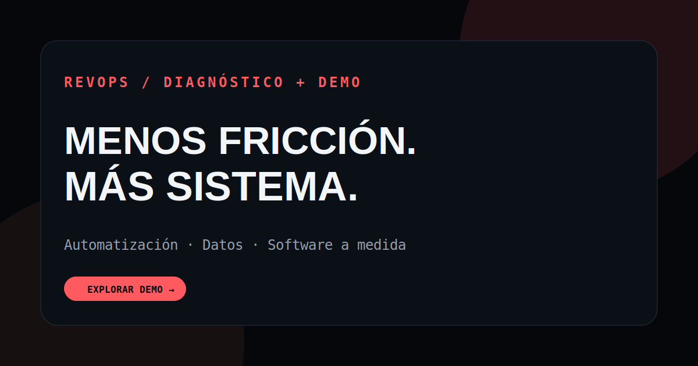

  

<h1 align="center">RevOps Studio</h1>
<h3 align="center">Customer Success × Operations × Data × Applied AI</h3>

<strong>Less operational friction. More clarity, useful decisions and systems people can trust.</strong>

<em>Independent systems studio by Gracián Baena · Murcia, Spain · Remote collaboration</em>

  <a href="https://gracianb.github.io/revops-studio/"><strong>Explore the studio ↗</strong></a> &nbsp;·&nbsp;
  <a href="https://gracianb.github.io/revops-studio/demo.html"><strong>Try the sample-data demo ↗</strong></a> &nbsp;·&nbsp;
  <a href="https://gracianb.github.io/revops-studio/#contacto"><strong>Discuss a problem ↗</strong></a>

---

## What RevOps Studio is for

Most operational problems do not begin with a missing dashboard. They begin with repeated manual work, contradictory data, opaque ownership, scattered knowledge or decisions that no one can explain.

**RevOps Studio explores how to turn those problems into practical workflows.** The public website presents a small independent services offer. The technical laboratory is a separate, browser-based demonstration of how operational reasoning and control mechanisms can work.

### Three ways I can help

| 01 · Automate | 02 · Make data usable | 03 · Build the right tool |
| --- | --- | --- |
| Reduce repeated manual steps and handoffs. | Design clearer signals, dashboards and quality checks. | Translate real workflows into purpose-built internal tools. |
| **Process mapping · automation · accountability** | **Data quality · reporting · decision support** | **Interfaces · rules · appropriately scoped AI** |

Engagement models and prices on the [public website](https://gracianb.github.io/revops-studio/) are indicative starting points, not quotes or guaranteed delivery timelines. Each project requires discovery and an agreed scope.

## Work you can inspect

| Evidence | What it demonstrates | Boundary |
| --- | --- | --- |
| [**Bodytone Support OS**](https://gracianb.github.io/professional-deck/proyecto-bodytone.html) | Customer Operations, Zendesk knowledge and service workflow design. | Public professional case; no internal customer records. |
| **Quoting workflow** | Documented experience turning a complex rules-based process into a more consistent tool. | Core logic and real operational data remain private. |
| **Contextual outreach workflow** | Process design across information, handoffs and outreach preparation. | Private operational core; no public customer data or conversion claims. |
| [**RevOps Control Room**](https://gracianb.github.io/revops-studio/demo.html) | Simulated CSV quality, policies, scenarios, decisions, traceability and human review. | **Fictional/sample data only; not a production CRM or ERP.** |

[**Explore the public service and case studies ↗**](https://gracianb.github.io/revops-studio/#casos)

## Try the technical demonstration

The **V104 browser demo** is a local, deterministic environment for exploring operational decisions. It includes examples of importing and checking CSV data, comparing scenarios, identifying risks and review gates, and generating inspectable reports.

The controls intentionally distinguish recommendations, rehearsals and human authorization. **Nothing here connects to a customer's CRM, ERP or private database, and it does not carry out live business actions.**

**[Open the interactive demonstration ↗](https://gracianb.github.io/revops-studio/demo.html)**

Do not upload real personal, confidential or customer data into a public demonstration. Detailed exports can contain the records you enter.

## Start with the actual problem

The website helps visitors describe the process they want to improve and explore possible approaches. Its contact form **uses FormSubmit**, a third-party email forwarding service, after the visitor accepts the privacy notice. Direct email and a link to check calendar availability are alternatives.

A form submission being accepted by a provider is **not** proof that an email was delivered or read. Please do not send passwords or sensitive information.

[**Discuss an operational challenge ↗**](https://gracianb.github.io/revops-studio/#contacto) · [**Privacy information ↗**](https://gracianb.github.io/revops-studio/privacidad.html) · [**Email directly ↗**](mailto:gracianbaenagonzalez@gmail.com)

## Why the boundaries matter

My background connects international Customer Success, operations, enablement and technical collaboration. I build demonstrations to make the underlying reasoning visible, not to invent evidence of ROI.

RevOps Studio V104 has a **published static demo** and an extensive set of versioned checks. That does not mean customer integrations, production authorization or external approvals exist. The enterprise execution boundary remains `productionGo: false`.

Technical documentation, releases and the complete historic development record are kept outside this visitor-facing README:

[**How the system works**](docs/OPERATING_MODEL.md) · [**V104 publication scope**](docs/V104-PUBLICACION-SITIO.md) · [**Full release history**](HISTORY.md) · [**Architecture**](docs/ARCHITECTURE.md)

## Three connected universes

RevOps Studio is one practical expression of a wider body of work:

[**Professional Deck**](https://gracianb.github.io/professional-deck/) · Customer Success, case studies and professional experience  
[**Yoga Instructor**](https://gracianb.github.io/yoga-instructor/) · Presence, movement and teaching  
[**Systems Lab**](https://gracianb.github.io/systems-lab/) · Interactive software, local AI and creative engineering

---

<strong>Understand the problem. Design the system. Make the result useful.</strong>

  <a href="https://gracianb.github.io/revops-studio/"><strong>RevOps Studio</strong></a> &nbsp;·&nbsp;
  <a href="https://www.linkedin.com/in/gracianbaena/"><strong>LinkedIn</strong></a> &nbsp;·&nbsp;
  <a href="https://gracianb.github.io/GracianB/"><strong>Personal hub</strong></a>

